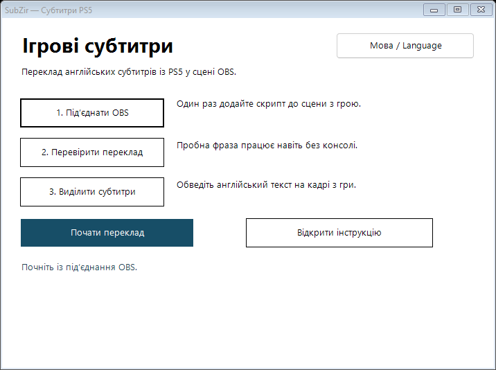

# SubZir for OBS

Translate English subtitles from a game running on your Windows PC or from a console connected through a capture card. Select the game's subtitle area once. SubZir shows each translated line in OBS and clears it when the text disappears.

**[Download SubZir for Windows x64](https://github.com/Daelon02/subzir-obs/releases/latest/download/PS5-Subtitles-Windows-x64.zip)** · [GPU pack with Hy-MT2 for RTX 5070 Ti](https://github.com/Daelon02/subzir-obs/releases/download/v0.3.0/SubZir-GPU-RTX-5070-Ti.zip) · [Українською](#перший-запуск) · [PS5 benchmark](docs/benchmarks/PS5-EN.md)


## First launch

1. Extract the entire ZIP to Documents and open **SubZir.exe**. Click **Language** to choose the **interface language** and **subtitle language** independently. Both lists have 100 languages. English subtitle output shows the original recognized line.
2. Enable **English subtitles** in the game. Choose how to bring its picture into your OBS scene.
   - **Game running on this PC.** Launch the game. In OBS, go to **Sources → + → Game Capture**, choose **Capture specific window**, then select the game window. This works without a console or capture card.
   - **Console.** Add the capture card as a **Video Capture Device**.
3. Click **1. Connect OBS** in SubZir. In OBS, open **Tools → Scripts → +**, paste the copied path and open the Lua file. Click the button in its settings to add subtitles to the scene.
4. Click **2. Test translation**. A translation of “Open the gate.” appears in OBS for four seconds. You can try this before connecting the console.
5. In OBS, open the settings beside **Start Virtual Camera**. Set the output to **Source**, select the Game Capture or capture-card source you added in step 2, then start the virtual camera. SubZir now sees the original game picture.
6. When dialogue appears, click **3. Select subtitle area**. Draw a box around the English text, leave room for two lines and save. Click **Start translation**. To switch the output while playing, use **Language**. The next new line uses your selection.

**Where will I see the translation while playing on PC?** The game window shows its original subtitles. The OBS scene shows the translated overlay, even with streaming and recording turned off. To see that scene full screen, right-click it in the **Scenes** list, choose **Open Scene Projector** and select a monitor. If you have two monitors, you can keep the game focused on one and the translated view on the other.

Requires Windows 10/11 x64, Windows English OCR and OBS Studio. The main ZIP includes QuickMT and M2M100 for CPU translation. English and Ukrainian have edited interface text. The other localizations are machine-assisted and their quality varies. Some scripts require supplemental Windows fonts. [Player guide and troubleshooting](docs/PLAYER-EN.txt) · [Supported languages](launcher/languages.json)


### Install your own translation model

1. Extract the Windows ZIP and locate the **SubZir** folder containing **SubZir.exe**. For GPU translation, open the **GPU pack** linked above. Drag its **hy-runtime** folder into **SubZir/app**. You should now see `SubZir/app/hy-runtime/llama-server.exe`. This pack also includes the ready-to-use Hy-MT2 model.
2. Close SubZir. Choose a single-file **GGUF text translation or instruction-tuned model** compatible with llama.cpp b11146. Check its model card for English input, your output language and support for user chat prompts. For a first test, try another quantization of Hy-MT2 1.8B, such as Q4_K_M. [Official Hy-MT2 GGUF files](https://huggingface.co/tencent/Hy-MT2-1.8B-GGUF)
3. Copy your file into **SubZir/app/models**. For example, `SubZir/app/models/Hy-MT2-1.8B-Q4_K_M.gguf`. Keep the original filename. You can put several GGUF files side by side. Leave the bundled model in **hy-runtime**.
4. Open **SubZir.exe**, choose the **subtitle language**, then choose your filename under **Translation model**. Click **Test translation**. When the translated demo line appears in OBS, the model is ready.

The GPU menu is available for the [target languages configured for this backend](worker/hy-languages.json). Your model must also support the chosen language. GGUF describes a file format. Speech models such as Whisper, adapter-only files and models requiring a custom prompt protocol are unsuitable for this loader. Larger models need more GPU memory and may take longer to translate. If a model fails, check `runtime/diagnostics.txt` and switch back to Hy-MT2 or Automatic. To remove a custom model, close SubZir and delete just its file from `app/models`.

## Перший запуск

SubZir зчитує англійські субтитри з гри на ПК або з консолі, під’єднаної через карту захоплення, й показує переклад у сцені OBS. Один застосунок має 100 мов меню й 100 варіантів для субтитрів. Наприклад, можна залишити меню українською й показувати переклад польською. Обидва налаштування зберігаються.

1. Розпакуйте весь ZIP у «Документи» й відкрийте **SubZir.exe**. Натисніть **Мова / Language** та виберіть окремо мову інтерфейсу й мову субтитрів.
2. У грі ввімкніть **англійські субтитри**. Додайте зображення гри до сцени OBS.
   - **Гра на цьому ПК.** Запустіть гру. В OBS відкрийте **Джерела → + → Захоплення гри**, виберіть режим захоплення окремого вікна, а потім вікно гри. Для цього достатньо самого ПК.
   - **Консоль.** Додайте карту захоплення як **Пристрій захоплення відео**.
3. У SubZir натисніть **1. Під’єднати OBS**. В OBS відкрийте **Інструменти → Скрипти → +**, вставте скопійований шлях і відкрийте файл. Натисніть кнопку додавання субтитрів у налаштуваннях скрипту.
4. Натисніть **2. Перевірити переклад**. На чотири секунди у сцені з’явиться переклад «Open the gate.» вибраною мовою. Для цього тесту консоль можна під’єднати пізніше.
5. У налаштуваннях віртуальної камери OBS виберіть вихід **Джерело**, потім джерело з кроку 2 — захоплення гри або карту захоплення. Запустіть віртуальну камеру. Тепер SubZir бачить вихідне зображення гри.
6. Коли з’явиться репліка, натисніть **3. Виділити субтитри**, обведіть область для двох рядків і збережіть її. Натисніть **Почати переклад**. Після перемикання мови наступна нова репліка з’явиться вибраною мовою.

**Де я побачу переклад під час гри на ПК?** У вікні гри видно оригінальні субтитри. Переклад з’являється у сцені OBS навіть без стріму чи запису. Щоб розгорнути сцену на весь екран, клацніть її правою кнопкою в списку **Сцени**, натисніть **Відкрити проєктор сцени** й виберіть монітор. Якщо маєте два монітори, можна грати на одному й бачити сцену з перекладом на другому.

Потрібні Windows 10/11 x64, компонент розпізнавання англійського тексту й OBS Studio. Для української комплект містить QuickMT, для інших перекладів — M2M100. Англійський режим показує розпізнаний оригінал. [Інструкція для гравця](docs/PLAYER-UA.txt) · [Заміри на підключеній PS5](docs/benchmarks/PS5-UK.md)




### Як встановити власну модель перекладу

1. Розпакуйте основний ZIP і знайдіть папку **SubZir** з **SubZir.exe**. Для перекладу на відеокарті відкрийте **GPU-пакет** за посиланням угорі README. Перетягніть папку **hy-runtime** з архіву в **SubZir/app**. Перевірте, що з’явився файл `SubZir/app/hy-runtime/llama-server.exe`. Готова модель Hy-MT2 уже є в цьому пакеті.
2. Закрийте SubZir. Завантажте **один файл .gguf** моделі для текстового перекладу або моделі, яка виконує текстові інструкції. Вона має працювати з llama.cpp b11146, приймати звичайний запит у чаті й підтримувати переклад з англійської на вашу мову. Для першої спроби підійде інший варіант Hy-MT2 1.8B, наприклад Q4_K_M. [Офіційні файли Hy-MT2 у форматі GGUF](https://huggingface.co/tencent/Hy-MT2-1.8B-GGUF)
3. Скопіюйте файл у **SubZir/app/models**. Приклад шляху — `SubZir/app/models/Hy-MT2-1.8B-Q4_K_M.gguf`. Залиште назву файлу як є. У цю папку можна додати кілька моделей. Штатна Hy-MT2 залишається в **hy-runtime**.
4. Запустіть **SubZir.exe**, виберіть **мову субтитрів**, а потім свій файл у списку **Модель перекладу**. Натисніть **Перевірити переклад**. Коли тестова репліка з’явиться в OBS, можна запускати гру.

Вибір GGUF доступний для [мов, які підтримує цей режим SubZir](worker/hy-languages.json). Опис самої моделі має підтверджувати підтримку потрібної мови. Файли Whisper, окремі адаптери й моделі зі спеціальним форматом запиту для цього способу не підходять. Більша модель потребує більше відеопам’яті й може перекладати повільніше. Якщо запуск не вдався, подробиці є в `runtime/diagnostics.txt`. Щоб повернутися до штатного режиму, виберіть **Автоматично** або **Hy-MT2**. Щоб прибрати свою модель, закрийте програму й видаліть її файл із `app/models`.

## For developers / Для розробників

### Model and appearance controls

Open **Translation model** before starting translation. **Automatic** uses QuickMT for Ukrainian and M2M100 for the other translated languages. You can also choose M2M100 for Ukrainian. With the optional CUDA pack installed, supported languages also offer **Hy-MT2 1.8B Q6_K**. Stop translation to change models. **Subtitle appearance** lets you change the font, size, text color, background, opacity and outline while viewing the scene. Load the Lua script from the same folder as the launcher. [RTX 3080 comparison and sample translations](docs/benchmarks/RTX3080-EN.md)

Відкрийте **Модель перекладу** перед початком гри. В автоматичному режимі для української працює QuickMT. Вручну можна вибрати M2M100 або, за наявності пакета CUDA, Hy-MT2. Щоб змінити модель під час гри, зупиніть переклад. Кнопка **Вигляд субтитрів** дозволяє під час перекладу змінювати шрифт, розмір, колір, тло, непрозорість і контур. Для цього завантажте в OBS скрипт Lua з папки цієї збірки. [Порівняння на RTX 3080 і приклади перекладу](docs/benchmarks/RTX3080-UK.md)

### Build on Windows

Rust runs the capture, OCR, stability filter and overlay timing. The WinForms launcher writes both language choices to `runtime/languages.json`. The Python worker checks the target on each new input. It reuses the loaded CTranslate2 model across lines. The OBS Lua script updates a text source. Set `SUB_TARGET` to a code from `launcher/languages.json` to override the subtitle language when running the worker directly.

On Windows, install Rust MSVC and Visual Studio C++ Build Tools. Extract the **v0.2.0** Windows bundle to a test directory to supply embedded Python, FFmpeg and both model directories. From the repository root run the following commands.

```powershell
cargo build --release --locked
.\scripts\build.ps1 -BundleDirectory '.\PS5-Subtitles'
```

Для перевірки змін розпакуйте комплект v0.2.0, виконайте наведені команди й запустіть **SubZir.exe** у тестовій папці. Натисніть **Перевірити переклад**. Локалізації містяться в `launcher/locales`. Перелік кодів відповідає мовним токенам моделі. [Вимірювання та дані](docs/benchmarks/PS5-UK.md) · [Model and runtime notices](docs/COMPONENTS.txt)

To enable the optional GPU model in a developer build, create `app/hy-runtime` in the extracted bundle. Put `llama-server.exe`, its Windows x64 CUDA 12 DLLs, the matching CUDA runtime DLLs and `Hy-MT2-1.8B-Q6_K.gguf` together in that folder. The tested model has SHA-256 `d98fe604dec1f28f58f80d7d560f7177e584d3b8e5835862687660e5ff97cb40`. Relaunch SubZir and select a supported target language. [llama.cpp b11146 and CUDA libraries](https://github.com/ggml-org/llama.cpp/releases/tag/b11146) · [Pinned model files](https://huggingface.co/tencent/Hy-MT2-1.8B-GGUF/tree/a0c709d9fac510f2c807aa3af52872340dc37a4a)

## License / Ліцензія

Daelon02 licenses original SubZir code and documentation under MIT. You may copy, modify and redistribute them, including commercially. Keep the copyright notice and license text in copies or substantial portions. Сторонні компоненти поширюються за власними ліцензіями. [MIT](LICENSE) · [Third-party notices](docs/COMPONENTS.txt)
