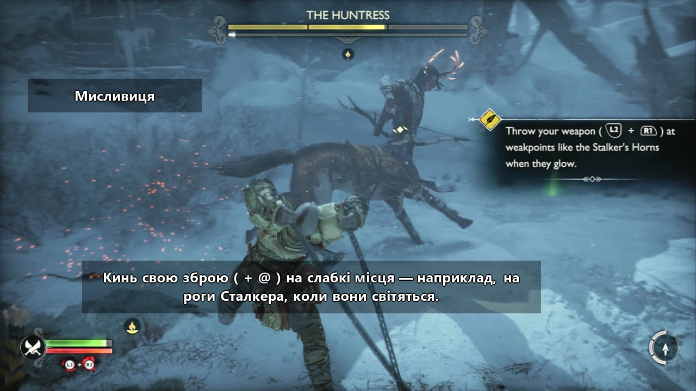
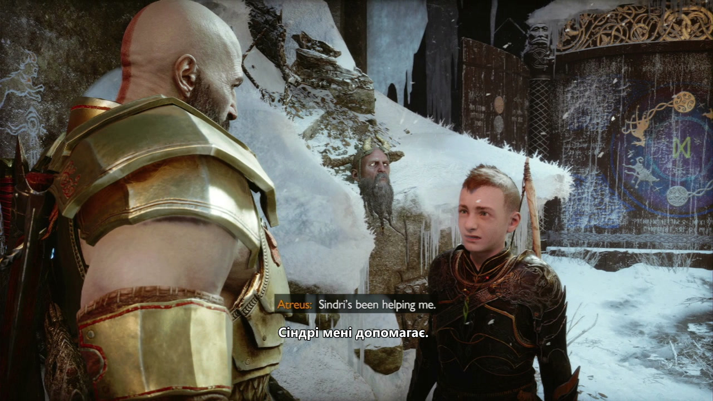
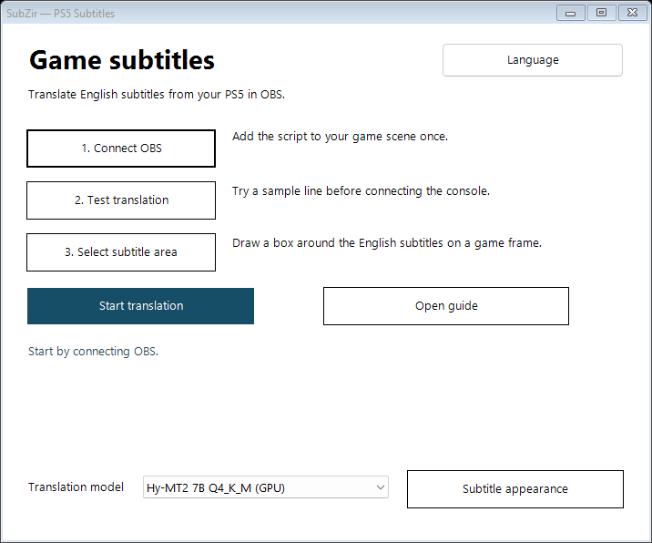
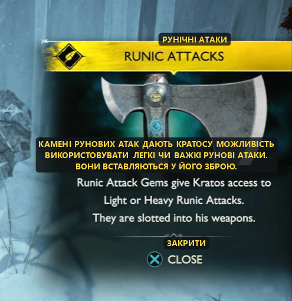
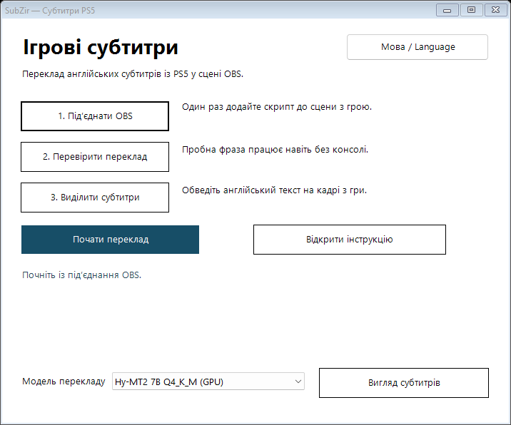

# SubZir for OBS

Translate English subtitles from a game running on your Windows PC or from a console connected through a capture card. Mark up to eight areas on one game frame, such as dialogue, objectives and menu labels. Place each translation in the editor. SubZir displays them in OBS and clears each one when its original disappears.

**[Download SubZir-Setup.exe for Windows](https://github.com/Daelon02/subzir-obs/releases/latest/download/SubZir-Setup.exe)** · [Illustrated player guide](docs/PLAYER-EN.md) · [Інструкція гравця зі скриншотами](docs/PLAYER-UA.md)

[Multiple zones and HUD (English)](#multiple-zones-and-hud-above-original) · [Кілька зон і HUD (українською)](#кілька-зон-і-hud-над-оригіналом)

Open **SubZir-Setup.exe**, choose **Hy-MT2 7B**, **QuickMT** or **M2M100**, then click **Install**. Setup downloads and checks the files for your selection. Setup detects compatible NVIDIA hardware for Hy-MT2 7B and downloads its CUDA package automatically (6.10–6.28 GB). QuickMT and M2M100 share the 0.85 GB CPU download. The model you choose is active on first launch. Choose a parent folder such as `D:\Games`. Setup shows the final path and installs SubZir in `D:\Games\SubZir`. Open SubZir from the Start menu after installation. [Offline packages](https://github.com/Daelon02/subzir-obs/releases/tag/v0.4.0)



## First launch

1. Click **Open SubZir** when setup finishes. Click **Language** to choose the **interface language** and **subtitle language** independently. Both lists have 100 languages. English subtitle output shows the original recognized line.
2. Enable **English subtitles** in the game. Choose how to bring its picture into your OBS scene.
   - **Game running on this PC.** Launch the game. In OBS, go to **Sources → + → Game Capture**, choose **Capture specific window**, then select the game window. This works without a console or capture card.
   - **Console.** Add the capture card as a **Video Capture Device**.
3. Click **1. Connect OBS** in SubZir. In OBS, open **Tools → Scripts → +**, paste the copied path and open the Lua file. Click the button in its settings to add subtitles to the scene.
4. Click **2. Test translation**. With saved zones, SubZir reads one game frame and shows the translations in OBS. Before setting up zones you can try the demo line “Open the gate.” without a console.
5. In OBS, open the settings beside **Start Virtual Camera**. Set the output to **Source**, select the Game Capture or capture-card source you added in step 2, then start the virtual camera. SubZir now sees the original game picture.
6. When dialogue appears, click **3. Select subtitle area**. Draw a box around the English text, leave room for two lines and save. Click **Start translation**. To switch the output while playing, use **Language**. The next new line uses your selection.

**Where will I see the translation while playing on PC?** The game window shows its original subtitles. The OBS scene shows the translated overlay, even with streaming and recording turned off. To see that scene full screen, right-click it in the **Scenes** list, choose **Open Scene Projector** and select a monitor. If you have two monitors, you can keep the game focused on one and the translated view on the other.

Requires Windows 10/11 x64, Windows English OCR and OBS Studio. The main ZIP includes QuickMT and M2M100 for CPU translation. English and Ukrainian have edited interface text. The other localizations are machine-assisted and their quality varies. Some scripts require supplemental Windows fonts. [Player guide and troubleshooting](docs/PLAYER-EN.txt) · [Supported languages](launcher/languages.json)





### Multiple zones and HUD above original

1. In OBS, select your game source as the **Virtual Camera** output and start the camera. Under **Tools → Scripts**, add the installed `OBS/PS5-Subtitles.lua` and use its button to add subtitles to the current scene. When upgrading from v0.9.0, reload this script once or restart OBS. Subsequent overlay updates load automatically while OBS is open. SubZir shows confirmation beside **Connect OBS**.
2. In SubZir, click **Zone editor · OBS** while the English text is visible. To practise on a recording, choose **Zone editor · video file** instead.
3. Select **Draw OCR area** and draw the yellow box around one English text block. Drag inside the blue output box to move it. Drag its edges or corners to resize. **Text and outline…** sets the font, text color and outline for the selected zone.
4. Click **Add zone** for a menu, a map legend or a message. Draw one yellow box around the group and choose **Above each text block** or **Below each text block**. SubZir positions each translation relative to the detected label, including commands arranged side by side. Keep game dialogue in its own regular zone.
5. Click **Save zones**, then **Start translation**. OBS displays one transparent layer with all the translations. The layout is saved for the next launch. To return to one subtitle area, use the original single-area picker.

If the scene contains one visible top-level game, capture-card or video source, the layer follows that source. In other scenes, positions use the full OBS canvas.



In v0.8.0, SubZir samples the game at 15 frames per second. For dialogue, select **Above original** in the zone editor. For an objective, select **Below original**. The translation is centered on its reading area. Choose **Outline color** under **Subtitle appearance** to change the text outline in OBS.

### Install your own translation model

In v0.9.0, each dialogue zone remembers up to six confirmed English lines. Hy-MT2 and custom GGUF models receive the latest line and up to one relevant earlier line, in dialogue order. When a new lower line appears beneath a confirmed subtitle, SubZir keeps the upper translation and translates the addition using the previous dialogue as context. You can switch to a single capture area and reopen the zone editor later to restore your layout. A subtitle stays in context while it is visible. History resets once more than eight seconds have passed since the last confirmed line was seen. If OCR consistently reads a different final period, question mark or exclamation mark for four frames, SubZir updates that line in place.

1. Install your GPU edition and find **SubZir.exe**. Hy-MT2 7B is already in **app/models**. On first launch with Ukrainian output, the launcher selects **Hy-MT2 7B Q4_K_M (GPU)**.

2. Close SubZir. Choose a single-file **GGUF text translation or instruction-tuned model** compatible with llama.cpp b11146. Check its model card for English input, your output language and support for user chat prompts. For a first test, try another quantization of Hy-MT2 1.8B, such as Q4_K_M. [Official Hy-MT2 GGUF files](https://huggingface.co/tencent/Hy-MT2-1.8B-GGUF)
3. Copy your file into **SubZir/app/models**. For example, `SubZir/app/models/Hy-MT2-1.8B-Q4_K_M.gguf`. Keep the original filename. You can put several GGUF files side by side. Keep the bundled 7B file in **app/models**.
4. Open **SubZir.exe**, choose the **subtitle language**, then choose your filename under **Translation model**. Click **Test translation**. When the translated demo line appears in OBS, the model is ready.

The GPU menu is available for the [target languages configured for this backend](worker/hy-languages.json). Your model must also support the chosen language. GGUF describes a file format. Speech models such as Whisper, adapter-only files and models requiring a custom prompt protocol are unsuitable for this loader. Larger models need more GPU memory and may take longer to translate. If a model fails, check `runtime/diagnostics.txt` and switch back to Hy-MT2 or Automatic. To remove a custom model, close SubZir and delete just its file from `app/models`.

**Updates.** Stop translation, click **Check for updates** and confirm the new version. To upgrade from v0.4.0, close SubZir and run the installer once. Select the folder containing your existing **SubZir.exe** to keep your models, subtitle area and OBS settings.

## Перший запуск

1. Запустіть **SubZir-Setup.exe**, виберіть **Hy-MT2 7B**, **QuickMT** або **M2M100** і натисніть **Встановити**. Для Hy-MT2 7B інсталятор автоматично визначає сумісну NVIDIA та завантажує пакет CUDA (6,10–6,28 ГБ). QuickMT і M2M100 мають спільний пакет для CPU (0,85 ГБ). Вибрана модель буде активна при першому запуску. Виберіть папку, наприклад `D:\Ігри`. Інсталятор покаже повний шлях і встановить програму в `D:\Ігри\SubZir`. Коли програма завантажить і перевірить файли, натисніть **Відкрити SubZir**. Натисніть **Мова / Language** та виберіть окремо мову інтерфейсу й мову субтитрів.
2. У грі ввімкніть **англійські субтитри**. Додайте зображення гри до сцени OBS.
   - **Гра на цьому ПК.** Запустіть гру. В OBS відкрийте **Джерела → + → Захоплення гри**, виберіть режим захоплення окремого вікна, а потім вікно гри. Для цього достатньо самого ПК.
   - **Консоль.** Додайте карту захоплення як **Пристрій захоплення відео**.
3. У SubZir натисніть **1. Під’єднати OBS**. В OBS відкрийте **Інструменти → Скрипти → +**, вставте скопійований шлях і відкрийте файл. Натисніть кнопку додавання субтитрів у налаштуваннях скрипту.
4. Натисніть **2. Перевірити переклад**. Якщо зони вже збережені, SubZir прочитає один кадр гри й покаже переклади в OBS. До налаштування зон можна перевірити демонстраційну фразу «Open the gate.» навіть без консолі.
5. У налаштуваннях віртуальної камери OBS виберіть вихід **Джерело**, потім джерело з кроку 2 — захоплення гри або карту захоплення. Запустіть віртуальну камеру. Тепер SubZir бачить вихідне зображення гри.
6. Коли з’явиться репліка, натисніть **3. Виділити субтитри**, обведіть область для двох рядків і збережіть її. Натисніть **Почати переклад**. Після перемикання мови наступна нова репліка з’явиться вибраною мовою.

**Де я побачу переклад під час гри на ПК?** У вікні гри видно оригінальні субтитри. Переклад з’являється у сцені OBS навіть без стріму чи запису. Щоб розгорнути сцену на весь екран, клацніть її правою кнопкою в списку **Сцени**, натисніть **Відкрити проєктор сцени** й виберіть монітор. Якщо маєте два монітори, можна грати на одному й бачити сцену з перекладом на другому.

Потрібні Windows 10/11 x64, компонент розпізнавання англійського тексту й OBS Studio. Для української комплект містить QuickMT, для інших перекладів — M2M100. Англійський режим показує розпізнаний оригінал. [Інструкція для гравця](docs/PLAYER-UA.txt) · [Заміри на підключеній PS5](docs/benchmarks/PS5-UK.md)




### Кілька зон і HUD над оригіналом

1. У налаштуваннях **віртуальної камери OBS** виберіть вихід **Джерело**, укажіть гру й запустіть камеру. Через **Інструменти → Скрипти** додайте встановлений `OBS/PS5-Subtitles.lua` й натисніть його кнопку додавання субтитрів до поточної сцени. При переході з v0.9.0 один раз перезавантажте цей скрипт або перезапустіть OBS. Наступні оновлення модуля застосовуються автоматично у відкритому OBS. Підтвердження з’являється в SubZir біля **Під’єднати OBS**.
2. Коли англійський текст з’явиться на екрані, у SubZir натисніть **Редактор зон · OBS**. Щоб спробувати на записі, виберіть **Редактор зон · відеофайл**.
3. Увімкніть **Виділити текст у грі** й обведіть жовтою рамкою один англійський напис. Перетягніть синю рамку за середину, щоб перемістити переклад, або за край чи кут, щоб змінити розмір. Кнопка **Текст і контур…** задає шрифт, колір тексту й контур для вибраної зони.
4. Натисніть **Додати зону** для меню, легенди карти або повідомлення. Обведіть усю групу однією жовтою рамкою та виберіть **Над кожним написом** або **Під кожним написом**. SubZir прив’яже переклад до відповідного напису, навіть коли кілька команд стоять в один ряд. Діалог залиште в окремій звичайній зоні.
5. Натисніть **Зберегти зони**, потім **Почати переклад**. Усі переклади з’являться в одному прозорому шарі OBS, а розташування збережеться для наступного запуску. Щоб повернутися до однієї області, натисніть **3. Виділити субтитри**.

Якщо в сцені є одне видиме ігрове, відео- або захоплювальне джерело верхнього рівня, шар повторює його положення. В інших сценах позиції відраховуються від усього полотна OBS.


У v0.8.0 SubZir зчитує гру з частотою 15 кадрів/с. У редакторі зон для діалогу виберіть **Над оригіналом**, а для завдання — **Під оригіналом**. Переклад центрується відносно своєї зони. У налаштуваннях вигляду субтитрів кнопка **Колір контуру** змінює колір обведення тексту в OBS.

### Як встановити власну модель перекладу

У v0.9.0 кожна зона діалогу пам’ятає до шести підтверджених англійських реплік. Hy-MT2 і власні GGUF отримують останню репліку й за можливості одну доречну ранішу в порядку розмови. Коли під підтвердженим субтитром з’являється новий рядок, SubZir зберігає готовий переклад верхнього й перекладає доданий текст із контекстом. Після переходу на одну область попередню розкладку можна знову відкрити в редакторі зон. Поки репліку видно на екрані, вона залишається в контексті. Історія скидається, коли від останнього розпізнавання підтвердженої репліки минає понад вісім секунд. Якщо чотири кадри поспіль закінчуються іншою крапкою, знаком питання чи оклику, SubZir оновлює ту саму репліку.

1. Встановіть GPU-збірку для своєї карти. Модель уже в **app/models**. Під час першого запуску з українськими субтитрами внизу буде вибрано **Hy-MT2 7B Q4_K_M (GPU)**.

2. Закрийте SubZir. Завантажте **один файл .gguf** моделі для текстового перекладу або моделі, яка виконує текстові інструкції. Вона має працювати з llama.cpp b11146, приймати звичайний запит у чаті й підтримувати переклад з англійської на вашу мову. Для першої спроби підійде інший варіант Hy-MT2 1.8B, наприклад Q4_K_M. [Офіційні файли Hy-MT2 у форматі GGUF](https://huggingface.co/tencent/Hy-MT2-1.8B-GGUF)
3. Скопіюйте файл у **SubZir/app/models**. Приклад шляху — `SubZir/app/models/Hy-MT2-1.8B-Q4_K_M.gguf`. Залиште назву файлу як є. У цю папку можна додати кілька моделей. Комплектна модель 7B зберігається в **app/models**.
4. Запустіть **SubZir.exe**, виберіть **мову субтитрів**, а потім свій файл у списку **Модель перекладу**. Натисніть **Перевірити переклад**. Коли тестова репліка з’явиться в OBS, можна запускати гру.

Вибір GGUF доступний для [мов, які підтримує цей режим SubZir](worker/hy-languages.json). Опис самої моделі має підтверджувати підтримку потрібної мови. Файли Whisper, окремі адаптери й моделі зі спеціальним форматом запиту для цього способу не підходять. Більша модель потребує більше відеопам’яті й може перекладати повільніше. Якщо запуск не вдався, подробиці є в `runtime/diagnostics.txt`. Щоб повернутися до штатного режиму, виберіть **Автоматично** або **Hy-MT2**. Щоб прибрати свою модель, закрийте програму й видаліть її файл із `app/models`.

SubZir зчитує англійські субтитри з гри на ПК або з консолі, під’єднаної через карту захоплення, й показує переклад у сцені OBS. Один застосунок має 100 мов меню й 100 варіантів для субтитрів. Наприклад, можна залишити меню українською й показувати переклад польською. Обидва налаштування зберігаються.

**Оновлення.** Зупиніть переклад, натисніть **Оновити** і підтвердьте нову версію. Якщо у вас v0.4.0, закрийте SubZir, запустіть інсталятор і виберіть папку, де вже лежить **SubZir.exe**. Встановлені моделі, область субтитрів і налаштування OBS збережуться.

## For developers / Для розробників

### Model and appearance controls

Open **Translation model** before starting translation. **Automatic** uses QuickMT for Ukrainian and M2M100 for the other translated languages. You can also choose M2M100 for Ukrainian. The GPU editions include **Hy-MT2 7B Q4_K_M**. Older installations with 1.8B can still select it. Stop translation to change models. **Subtitle appearance** lets you change the font, size, text color, background, opacity and outline while viewing the scene. Load the Lua script from the same folder as the launcher. [RTX 3080 comparison and sample translations](docs/benchmarks/RTX3080-EN.md)

Відкрийте **Модель перекладу** перед початком гри. В автоматичному режимі для української працює QuickMT. Вручну можна вибрати M2M100 або комплектну Hy-MT2 7B у GPU-збірках. Щоб змінити модель під час гри, зупиніть переклад. Кнопка **Вигляд субтитрів** дозволяє під час перекладу змінювати шрифт, розмір, колір, тло, непрозорість і контур. Для цього завантажте в OBS скрипт Lua з папки цієї збірки. [Порівняння на RTX 3080 і приклади перекладу](docs/benchmarks/RTX3080-UK.md)

With Ukrainian subtitle output and **Hy-MT2 7B Q4_K_M**, tick **Concise dialogue** in the main window before starting translation. Clear it for standard dialogue. SubZir remembers your choice. **Zone setup guide** walks you through positioning separate dialogue, objective and menu regions. [Dialogue and HUD benchmarks](docs/benchmarks/CONTEXT-HUD-EN.md)

Виберіть українську мову субтитрів і **Hy-MT2 7B Q4_K_M**. Перед запуском перекладу ввімкніть **Стислий діалог** у головному вікні. Зніміть позначку для звичайного режиму. SubZir запам’ятає вибір. Кнопка **Як налаштувати зони** показує, як окремо розмістити діалог, завдання та підказки меню. [Заміри діалогів і HUD](docs/benchmarks/CONTEXT-HUD-UK.md)

### Build on Windows

Rust runs the capture, OCR, stability filter and overlay timing. The WinForms launcher writes both language choices to `runtime/languages.json`. The Python worker checks the target on each new input. It reuses the loaded CTranslate2 model across lines. The OBS Lua script updates a text source. Set `SUB_TARGET` to a code from `launcher/languages.json` to override the subtitle language when running the worker directly.

On Windows, install Rust MSVC and Visual Studio C++ Build Tools. Extract the **v0.4.0** Windows bundle to a test directory to supply embedded Python, FFmpeg and both model directories. From the repository root run the following commands.

```powershell
.\scripts\build-setup.ps1 -Destination .\dist
cargo build --release --locked
.\scripts\build.ps1 -BundleDirectory '.\PS5-Subtitles'
```

Для перевірки змін розпакуйте комплект v0.4.0, виконайте наведені команди й запустіть **SubZir.exe** у тестовій папці. Натисніть **Перевірити переклад**. Локалізації містяться в `launcher/locales`. Перелік кодів відповідає мовним токенам моделі. [Вимірювання та дані](docs/benchmarks/PS5-UK.md) · [Model and runtime notices](docs/COMPONENTS.txt)

For GPU development, build against an extracted GPU edition. Keep llama.cpp b11146 and its CUDA DLLs in `app/hy-runtime` and the bundled weights in `app/models/Hy-MT2-7B-Q4_K_M.gguf`. SubZir applies its conversational prompt for English-to-Ukrainian translation with this file. [Tencent model files](https://huggingface.co/tencent/Hy-MT2-7B-GGUF/tree/ab8472660ac61fac25f1af43fac2599d52a8a775)

## License / Ліцензія

Daelon02 licenses original SubZir code and documentation under MIT. You may copy, modify and redistribute them, including commercially. Keep the copyright notice and license text in copies or substantial portions. Сторонні компоненти поширюються за власними ліцензіями. [MIT](LICENSE) · [Third-party notices](docs/COMPONENTS.txt)
