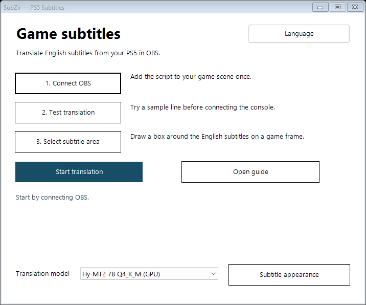
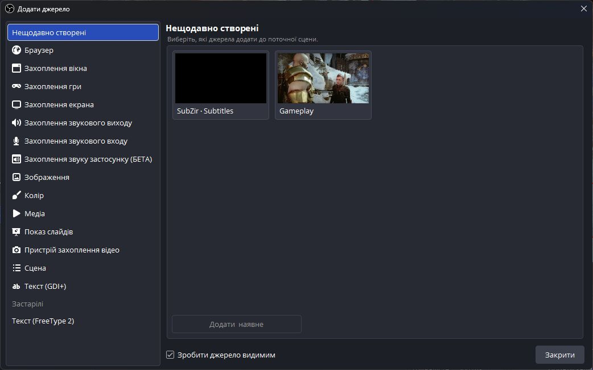
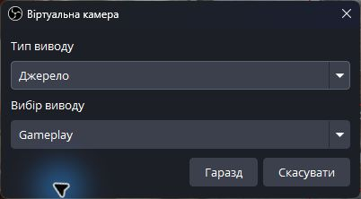
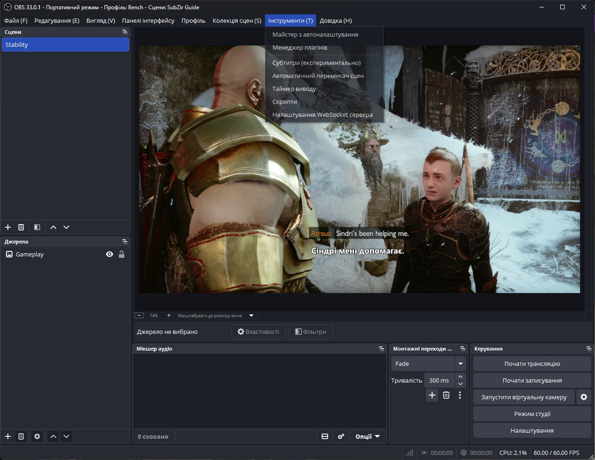
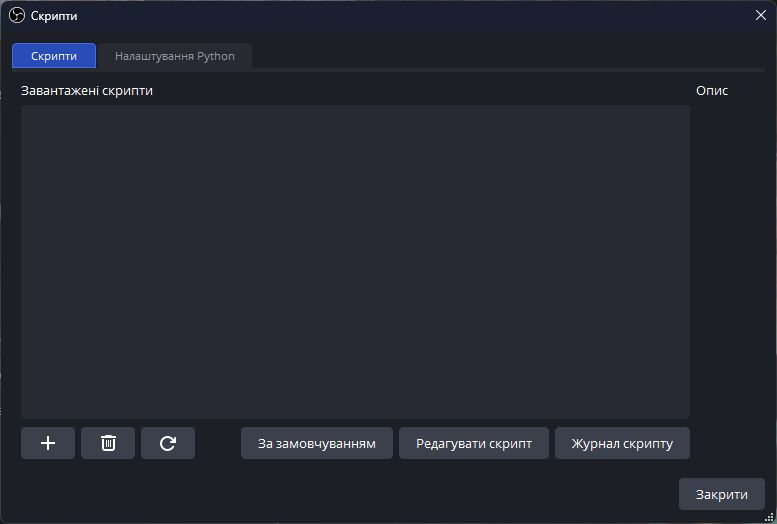
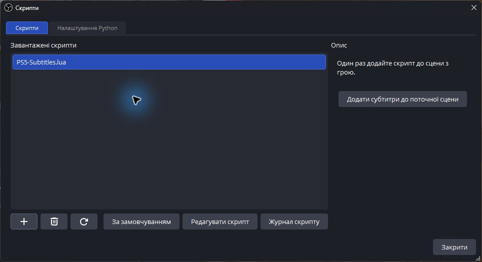
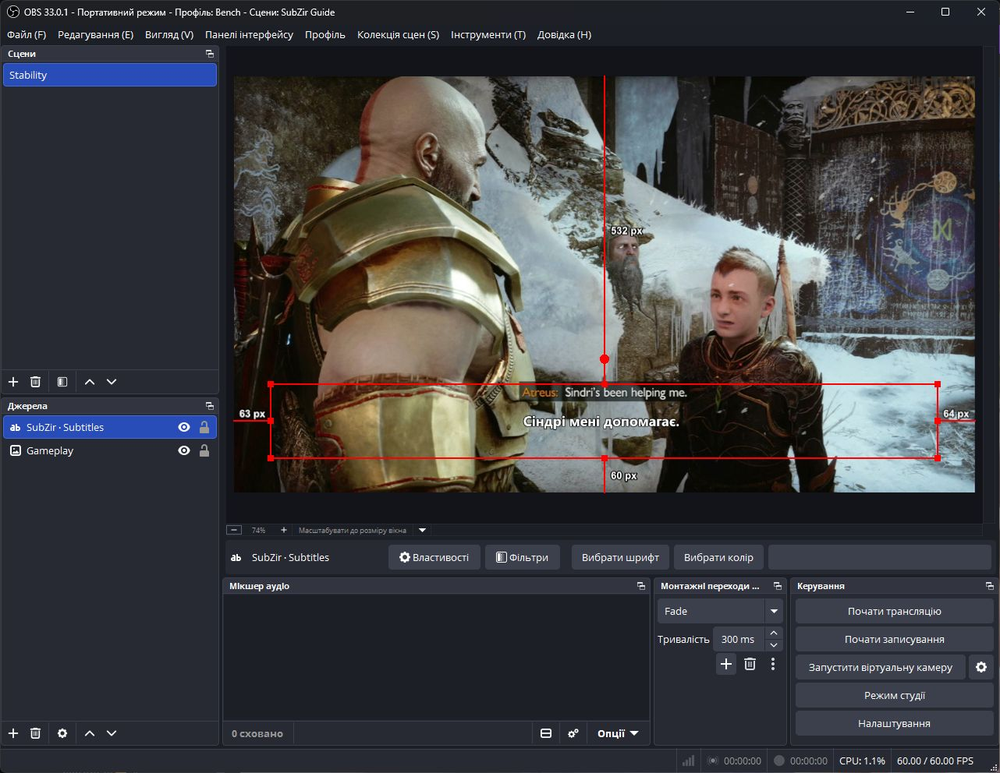
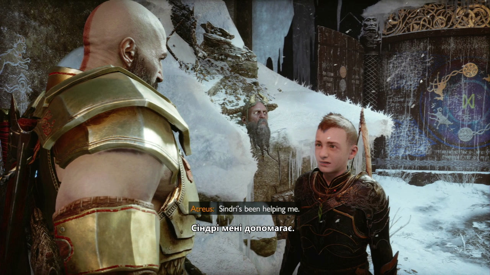

# SubZir player guide

SubZir reads a game's English subtitles and displays their translation in your OBS scene. For a PC game you need OBS Studio. For a PS5 you also need a capture card that shows the console picture in OBS.

## 1. Get the edition for your PC

- **RTX 5070 Ti** — download every part of `SubZir-7B-RTX-5070-Ti.zip` from the same release.
- **RTX 3080** — download every part of `SubZir-7B-RTX-3080.zip`.
- **CPU translation** — download `PS5-Subtitles-Windows-x64.zip`.

Put all parts of your edition in one folder. In 7-Zip open the file ending in **.zip.001**, click **Extract** and choose a folder in Documents. If you already have a complete **.zip**, use **Extract All**. Open **SubZir.exe** in the extracted **SubZir** folder. Both GPU editions include the 7B model. On first launch with Ukrainian output, look for **Hy-MT2 7B Q4_K_M (GPU)** at the bottom of the window.

## 2. Bring the game into OBS

1. Open the game and turn on **English subtitles** in its settings.
2. Select your game scene and click **+** under **Sources**. For PC select **Game Capture → Capture specific window** and pick the game. For PS5 select **Video Capture Device** and pick your capture card. Check the preview. The OBS screenshots below show the Ukrainian interface.

   

3. In **Controls**, click the gear next to **Start Virtual Camera**. Set **Output Type** to **Source** and choose your game or capture card in **Output Selection**. The example source is named **Gameplay**. Click **OK**, then **Start Virtual Camera**.

   

## 3. Connect SubZir to your OBS scene

1. In SubZir click **1. Connect OBS** to copy the script path. In OBS open **Tools → Scripts** in the top menu.

   

2. Under **Loaded Scripts**, click the **+** in the bottom left. Press **Ctrl+V** in the **File name** field, then click **Open**. You can also browse to **SubZir → OBS → PS5-Subtitles.lua** in your extracted edition.

   

3. Select **PS5-Subtitles.lua** on the left. On the right click **Add subtitles to the current scene**, then **Close**.

   

4. Under **Sources**, check that **SubZir · Subtitles** appears **above the game** and has its eye icon on. Drag it up if needed. The red outline in the example shows the selected subtitle source in OBS.

   

## 4. Test translation and start playing

1. Click **Language** in SubZir and choose your interface and subtitle languages separately. Click **2. Test translation**. The translation of “Open the gate.” appears in the OBS scene for about four seconds. You can test this before connecting a console.
2. Wait for dialogue. Click **3. Select subtitle area**, draw a box around the English text with room for two lines, then click **Save area**. In the example below select the upper line that says “Sindri’s been helping me.”
3. Click **Start translation**. Use **Subtitle appearance** to change the font, outline and background. For a full-screen view, right-click the scene in OBS, choose **Open Scene Projector** and select your monitor.

## If the translation is missing

- **The test line never appeared.** Open the correct OBS scene. Make sure the subtitle source is visible and sits above the game source in the Sources list.
- **The test worked but game dialogue is missing.** Check the virtual camera source. Draw the box again while a subtitle is visible. Repeat this after a game resolution change.
- **7B fails to start.** Check that all parts match your GPU edition, update your NVIDIA driver and restart SubZir. Select **Automatic** to use CPU translation while troubleshooting. Details are in `runtime/diagnostics.txt`.
