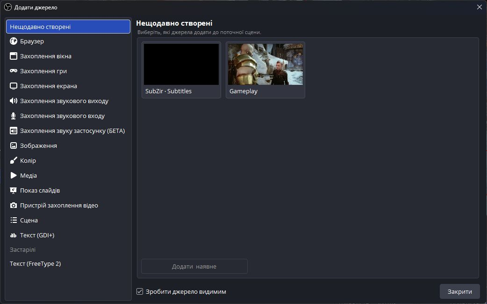
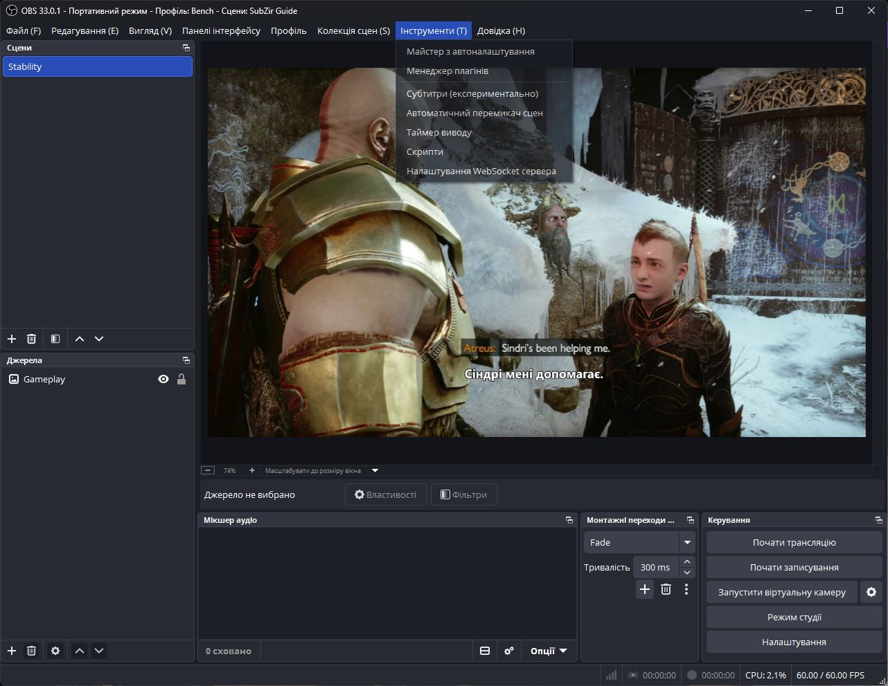

# SubZir — інструкція для гравця

SubZir читає англійські субтитри з гри й показує переклад у сцені OBS. Для гри на ПК достатньо OBS Studio. Для PS5 потрібна карта захоплення, через яку в OBS вже видно зображення з консолі.

## 1. Виберіть збірку

- **RTX 5070 Ti** — завантажте всі частини `SubZir-7B-RTX-5070-Ti.zip` з одного релізу.
- **RTX 3080** — завантажте всі частини `SubZir-7B-RTX-3080.zip`.
- **Для перекладу на процесорі** — завантажте `PS5-Subtitles-Windows-x64.zip`.

Покладіть частини своєї збірки в одну папку. У 7-Zip відкрийте файл із закінченням **.zip.001**, натисніть **Extract / Видобути** й виберіть папку в «Документах». Якщо у вас уже є цілий файл **.zip**, просто натисніть **Видобути все**. У розпакованій папці **SubZir** відкрийте **SubZir.exe**. Для GPU-збірок модель 7B уже всередині. На першому запуску для української внизу має бути **Hy-MT2 7B Q4_K_M (GPU)**.

## 2. Покажіть гру в OBS

1. Відкрийте гру й увімкніть **англійські субтитри** в її налаштуваннях.
2. В OBS виберіть сцену для гри. У панелі **Джерела** натисніть **+**. Для ПК виберіть **Захоплення гри → Захоплення конкретного вікна** й укажіть гру. Для PS5 виберіть **Пристрій захоплення відео** й укажіть карту. Переконайтеся, що гру видно у вікні OBS.

   

3. У панелі **Керування** натисніть шестерню праворуч від **Запустити віртуальну камеру**. У полі **Тип виводу** виберіть **Джерело**, а в полі **Вибір виводу** — ваше джерело гри або карти. На скриншоті воно називається **Gameplay**. Натисніть **Гаразд**, потім **Запустити віртуальну камеру**.

   

## 3. Підключіть SubZir до сцени OBS

1. У SubZir натисніть **1. Під’єднати OBS**. Програма скопіює шлях до файлу. В OBS відкрийте верхнє меню **Інструменти → Скрипти**.

   

2. У вікні **Скрипти** натисніть **+** внизу ліворуч. У полі **Ім’я файлу** натисніть **Ctrl+V**, потім **Відкрити**. Файл можна також знайти вручну в розпакованій папці **SubZir → OBS → PS5-Subtitles.lua**.

   

3. Виберіть **PS5-Subtitles.lua** у списку ліворуч. Праворуч натисніть **Додати субтитри до поточної сцени**, потім **Закрити**.

   

4. У панелі **Джерела** перевірте, що **SubZir · Subtitles** стоїть **над грою** та значок ока ввімкнений. Перетягніть джерело вище, якщо потрібно. Червона рамка на прикладі показує виділене джерело перекладу в OBS.

   

## 4. Перевірте переклад і почніть гру

1. У SubZir натисніть **Мова / Language**. Окремо виберіть мову меню й мову перекладу. Натисніть **2. Перевірити переклад**. У сцені OBS приблизно на чотири секунди з’явиться переклад «Open the gate.». Тест працює й до підключення консолі.
2. Дочекайтеся діалогу в грі. Натисніть **3. Виділити субтитри**, обведіть англійський текст із запасом на два рядки й натисніть **Зберегти область**. На прикладі нижче обводити слід верхню репліку «Sindri’s been helping me.».
3. Натисніть **Почати переклад**. Через **Вигляд субтитрів** можна змінити шрифт, обведення й тло. Для повноекранного перегляду натисніть правою кнопкою на сцену в OBS та відкрийте **Проєктор сцени** на потрібному моніторі.

## Якщо перекладу не видно

- **Тестова фраза не з’явилася.** Відкрийте потрібну сцену OBS і перевірте, чи увімкнений значок ока біля джерела субтитрів і чи стоїть воно вище за джерело гри.
- **Тест спрацював, а діалог із гри не перекладається.** Перевірте джерело віртуальної камери й повторіть виділення під час видимого діалогу. Після зміни роздільності гри виділіть область знову.
- **7B не запускається.** Перевірте, чи завантажено всі частини саме для вашої карти, оновіть драйвер NVIDIA та перезапустіть програму. Тимчасово виберіть **Автоматично** для перекладу на процесорі. Подробиці збою зберігаються у `runtime/diagnostics.txt`.
