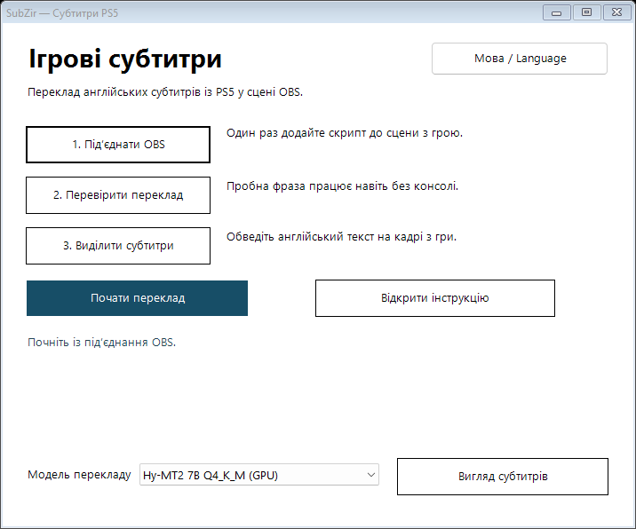
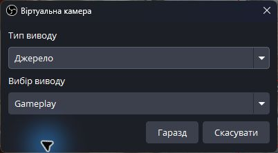
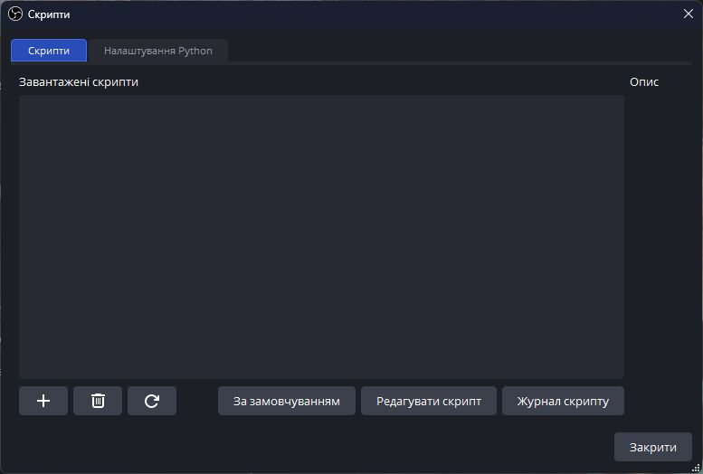
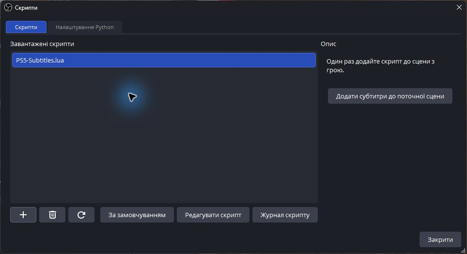
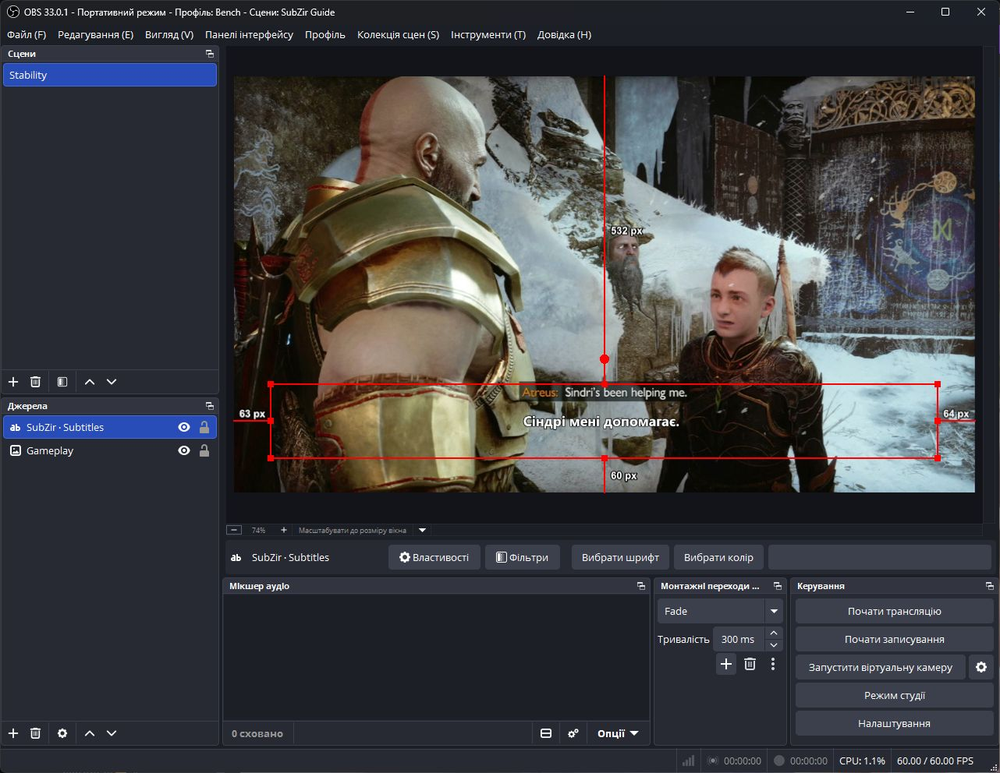
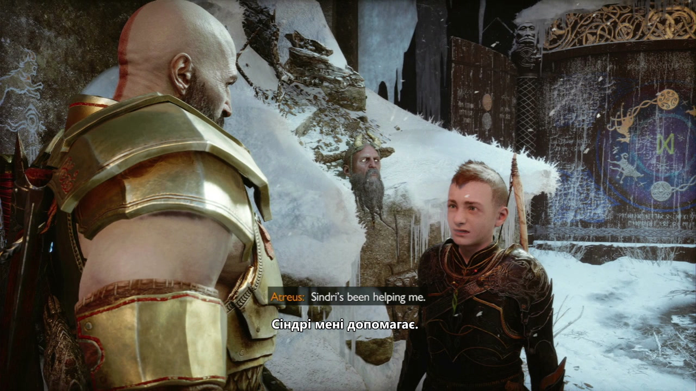
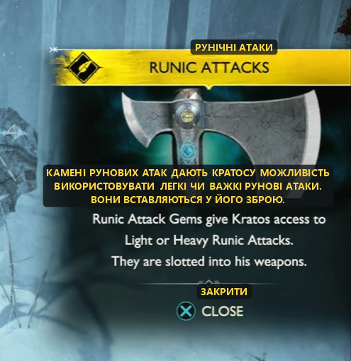

# SubZir — інструкція для гравця

SubZir читає англійські субтитри з гри й показує переклад у сцені OBS. Для гри на ПК достатньо OBS Studio. Для PS5 потрібна карта захоплення, через яку в OBS вже видно зображення з консолі.

## 1. Виберіть збірку

Запустіть **SubZir-Setup.exe**, виберіть **RTX 3080**, **RTX 5070**, **RTX 5070 Ti** або **CPU** та вкажіть, де встановити програму. Виберіть папку, наприклад `D:\Ігри`. Інсталятор покаже повний шлях і встановить програму в `D:\Ігри\SubZir`. Натисніть **Встановити**. Після встановлення натисніть **Відкрити SubZir**. Для кожної з цих відеокарт інсталятор завантажить модель Hy-MT2 7B. Зупиніть переклад, натисніть **Оновити** і підтвердьте нову версію. Якщо у вас v0.4.0, закрийте SubZir, запустіть інсталятор і виберіть папку, де вже лежить **SubZir.exe**. Встановлені моделі, область субтитрів і налаштування OBS збережуться.

## 2. Покажіть гру в OBS

1. Відкрийте гру й увімкніть **англійські субтитри** в її налаштуваннях.
2. В OBS виберіть сцену для гри. У панелі **Джерела** натисніть **+**. Для ПК виберіть **Захоплення гри → Захоплення конкретного вікна** й укажіть гру. Для PS5 виберіть **Пристрій захоплення відео** й укажіть карту. Переконайтеся, що гру видно у вікні OBS.

   

3. У панелі **Керування** натисніть шестерню праворуч від **Запустити віртуальну камеру**. У полі **Тип виводу** виберіть **Джерело**, а в полі **Вибір виводу** — ваше джерело гри або карти. На скриншоті воно називається **Gameplay**. Натисніть **Гаразд**, потім **Запустити віртуальну камеру**.

   

## 3. Підключіть SubZir до сцени OBS

1. У SubZir натисніть **1. Під’єднати OBS**. Програма скопіює шлях до файлу. В OBS відкрийте верхнє меню **Інструменти → Скрипти**.

   

2. У вікні **Скрипти** натисніть **+** внизу ліворуч. У полі **Ім’я файлу** натисніть **Ctrl+V**, потім **Відкрити**. Файл можна також знайти вручну в розпакованій папці **SubZir → OBS → PS5-Subtitles.lua**.

   

3. Виберіть **PS5-Subtitles.lua** у списку ліворуч. Праворуч натисніть **Додати субтитри до поточної сцени**, потім **Закрити**.

   

4. У панелі **Джерела** перевірте, що **SubZir · Subtitles** стоїть **над грою** та значок ока ввімкнений. Перетягніть джерело вище, якщо потрібно. Червона рамка на прикладі показує виділене джерело перекладу в OBS.

   

## 4. Перевірте переклад і почніть гру

1. У SubZir натисніть **Мова / Language**. Окремо виберіть мову меню й мову перекладу. Натисніть **2. Перевірити переклад**. У сцені OBS приблизно на чотири секунди з’явиться переклад «Open the gate.». Тест працює й до підключення консолі.
2. Дочекайтеся діалогу в грі. Натисніть **3. Виділити субтитри**, обведіть англійський текст із запасом на два рядки й натисніть **Зберегти область**. На прикладі нижче обводити слід верхню репліку «Sindri’s been helping me.».
3. Натисніть **Почати переклад**. Через **Вигляд субтитрів** можна змінити шрифт, обведення й тло. Для повноекранного перегляду натисніть правою кнопкою на сцену в OBS та відкрийте **Проєктор сцени** на потрібному моніторі.

## Якщо перекладу не видно

- **Тестова фраза не з’явилася.** Відкрийте потрібну сцену OBS і перевірте, чи увімкнений значок ока біля джерела субтитрів і чи стоїть воно вище за джерело гри.
- **Тест спрацював, а діалог із гри не перекладається.** Перевірте джерело віртуальної камери й повторіть виділення під час видимого діалогу. Після зміни роздільності гри виділіть область знову.
- **7B не запускається.** Перевірте, чи завантажено всі частини саме для вашої карти, оновіть драйвер NVIDIA та перезапустіть програму. Тимчасово виберіть **Автоматично** для перекладу на процесорі. Подробиці збою зберігаються у `runtime/diagnostics.txt`.

## Як налаштувати окремі зони

Ця інструкція також доступна без інтернету в головному вікні SubZir за кнопкою **Як налаштувати зони**.

1. В OBS відкрий сцену з грою. У налаштуваннях віртуальної камери вибери джерело гри й запусти камеру. Через Інструменти → Скрипти додай OBS/PS5-Subtitles.lua з папки SubZir та натисни кнопку додавання субтитрів до поточної сцени.

2. Відкрий гру в момент, коли видно англійський текст. У SubZir натисни «Редактор зон · OBS». Для тренування на записі вибери «Редактор зон · відеофайл».

3. Почни з діалогу. Увімкни «Виділити текст у грі» й обведи мишкою англійські субтитри, залишивши місце для другого рядка. Жовта рамка визначає, звідки читати текст. Вимкни виділення й перетягни приклад перекладу туди, де хочеш бачити його в OBS. Поле «Ширина, %» керує переносом рядків.

4. Натисни «Додати зону» для завдання або підказки й обведи її текст окремо. Для короткого пункту меню ввімкни «HUD над оригіналом». Залиши значок кнопки контролера поза жовтою рамкою. Для звичайного діалогу залиш HUD вимкненим. У списку «Зона» можна вибрати будь-яку з уже доданих зон і поправити її.

5. Натисни «Зберегти зони», потім «Почати переклад». Усі зони читаються з одного кадру й з’являються в OBS на одному прозорому шарі. Розташування збережеться після перезапуску. Можна додати до восьми зон.

